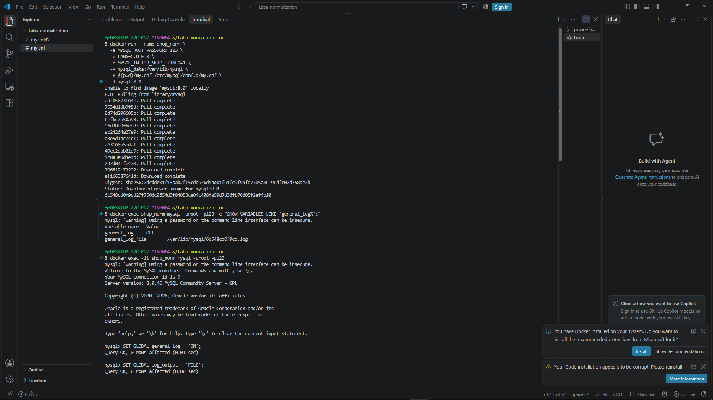
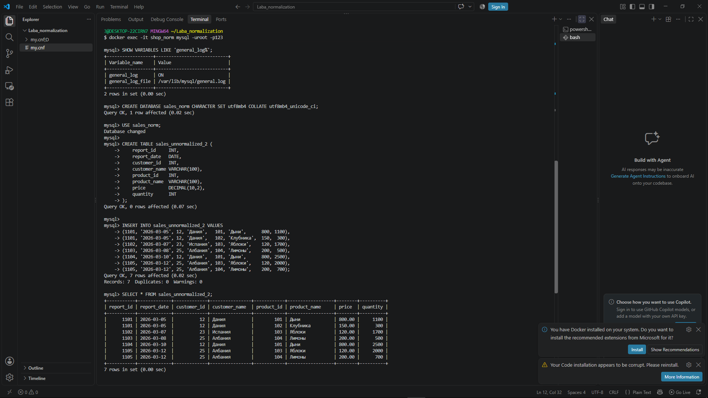
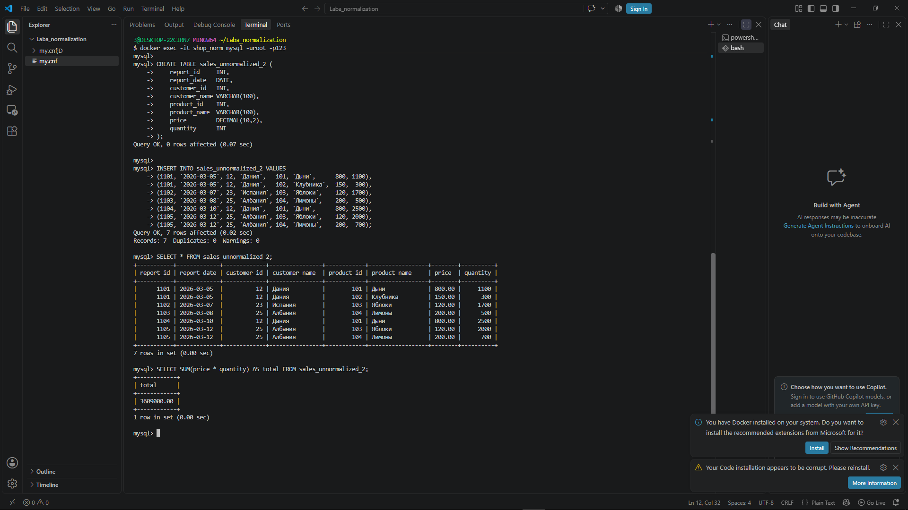
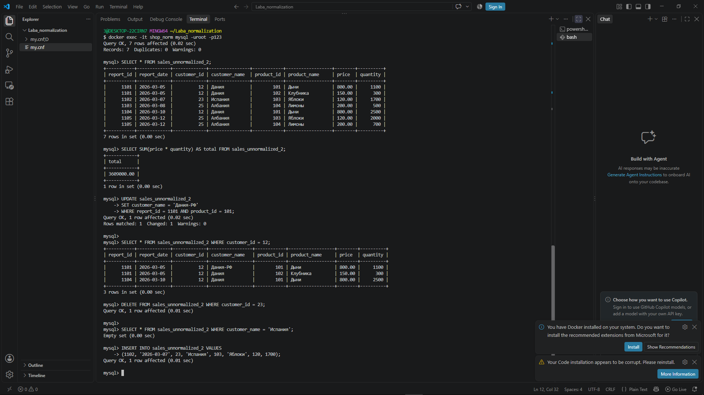
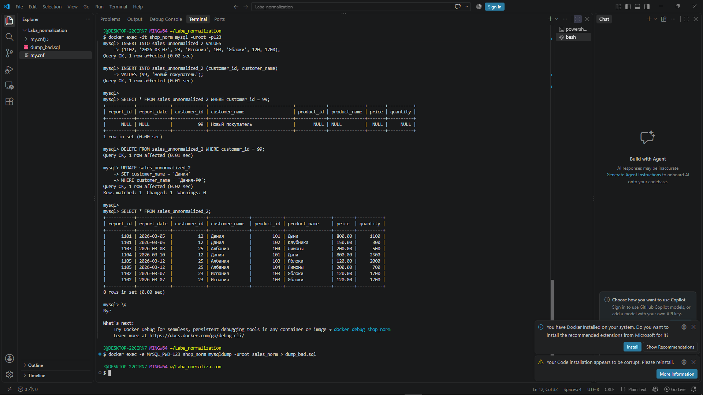
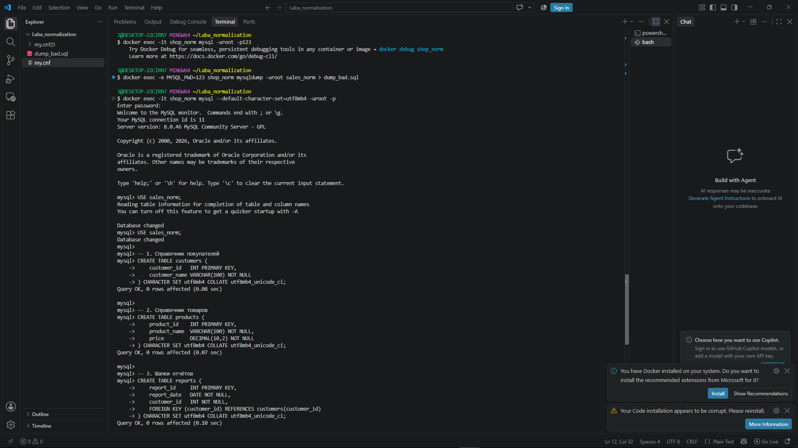
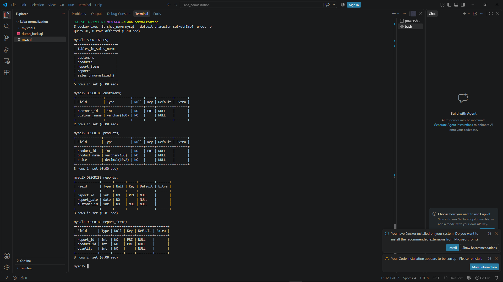
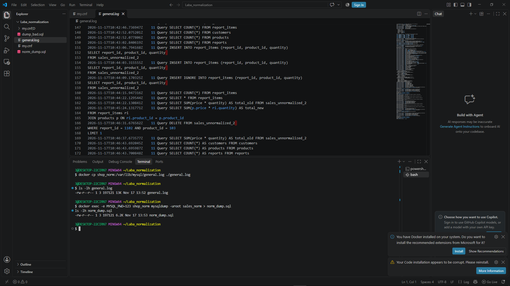
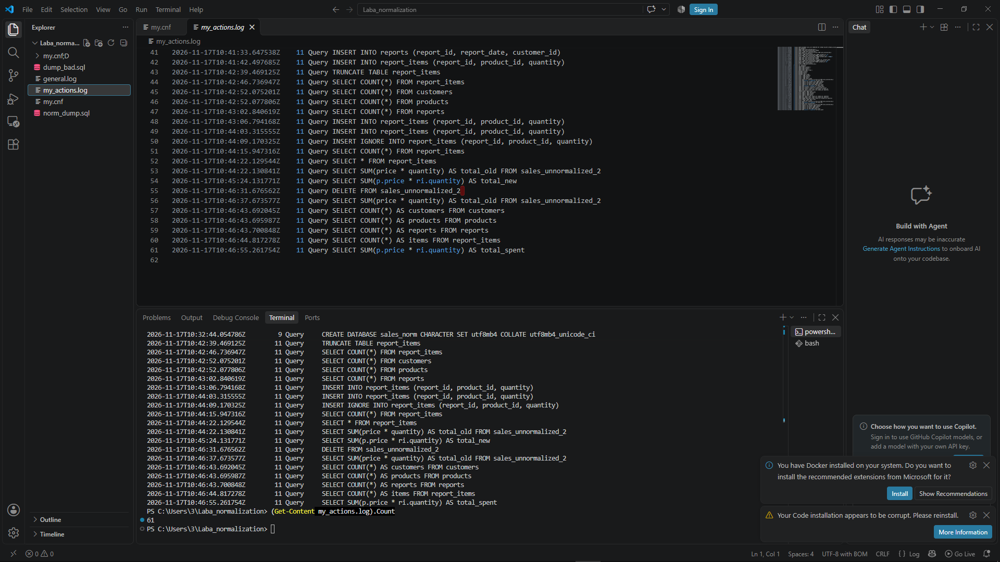

# 🗄️ Лабораторная работа №1: Нормализация данных в БД

Практическая работа по нормализации реляционной базы данных до третьей нормальной формы (3NF).

---

## 👨‍🎓 Информация о студенте

| Поле | Значение |
|------|----------|
| **ФИО** | Котохин Артём Ильич |
| **Курс** | 3 |
| **Специальность** | 09.02.07 «Информационные системы и программирование» |
| **Дата выполнения** | 17 ноября 2026 г. |

---

## 🎯 Цель работы

Изучить нормализацию реляционной базы данных до 3NF на примере таблицы продаж, устранить аномалии обновления, удаления и вставки.

---

## 📋 Задачи

1. Создать БД `sales_norm` и таблицу `sales_unnormalized_2`
2. Продемонстрировать аномалии обновления, удаления, вставки
3. Привести данные к 3NF — 4 таблицы (`customers`, `products`, `reports`, `report_items`)
4. Перенести данные через `INSERT ... SELECT`
5. Проверить целостность (сумма 3 609 000.00)
6. Сделать дампы до и после нормализации
7. Настроить логирование и экспортировать лог

---

## 🛠️ Технологии

- MySQL 8.0 (Docker)
- Windows 11 + Git Bash + PowerShell
- Visual Studio Code
- Git + GitHub

---

## 📁 Структура репозитория

```
Laba_normalization/
├── README.md
├── my.cnf
├── dump_bad.sql
├── norm_dump.sql
├── general.log
└── my_actions.log
```

---

## 📊 Результаты

| Метрика | Значение |
|---------|----------|
| Покупателей | 3 ✅ |
| Товаров | 4 ✅ |
| Отчётов | 5 ✅ |
| Позиций | 7 ✅ |
| Сумма заказов | 3 609 000.00 ✅ |
| Сумма покупок Дании (код 12) | 2 925 000.00 ✅ |

---

## 🧠 Выводы

1. **3NF устраняет аномалии** — обновление имени покупателя требует изменения только одной строки
2. **Данные не теряются** — проверка суммы подтверждает целостность
3. **Логирование через `general_log`** — удобный инструмент аудита

---

> **Котохин А.И.**, 2 курс, 09.02.07









